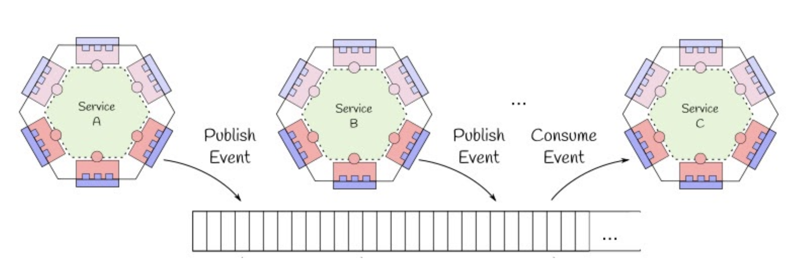

# Event-Store

The `event-store` is a Node.js library that provides the core components for implementing event sourcing in your microservices. It offers a simple and flexible way to store, publish, and subscribe to domain events.

## Core Concepts

*   **Event:** A record of something that has happened in the system. Events are immutable and represent the single source of truth.
*   **Aggregate:** A cluster of associated objects that we treat as a single unit for data changes. Each aggregate has a root and a boundary.
*   **Event Store:** A database that stores events. It provides an API for appending and retrieving events.
*   **Message Broker:** A component that facilitates communication between microservices by publishing and subscribing to events.

## Event Sourcing (ES) and CQRS

NebulaE leverages Event Sourcing (ES) as a fundamental architectural pattern. In Event Sourcing, all changes to the application state are captured as an immutable sequence of events. This approach provides a reliable audit trail, enables event replay for state reconstruction, and facilitates a loosely coupled architecture, which is crucial for microservices.

Complementing Event Sourcing, NebulaE also implements Command Query Responsibility Segregation (CQRS). CQRS dictates that a microservice should be broken into two distinct parts: one for writing data (commands) and one for reading data (queries).

In this context, the `event-store` library plays a pivotal role in the write-side of CQRS. It ensures that every state change within an aggregate is recorded as an event and persisted in an event repository, known as the event store. For example, if an `Account` aggregate undergoes changes like `Enabled`, `Credited`, `Debited`, or `Blocked`, each of these actions is stored as a separate event. To retrieve the current state of an `Account`, the system queries all relevant events for that specific account and reconstructs its state by applying these events in chronological order.

The read-side of CQRS, often referred to as the "materialized view," is handled by a separate database within each microservice. This database is optimized for querying and can use any technology or schema that best suits the microservice's needs. The `event-store` facilitates this by providing the mechanism for other microservices to react to published events and update their own materialized views accordingly.

This separation allows for independent scaling and optimization of read and write operations, leading to improved performance and flexibility in a microservices environment.



By implementing these techniques, multiple microservices can coexist on the Nebula platform without having to know other microservices. Each microservice, as an independent processing unit, only reacts to events and generates other events.

## Architecture

The `event-store` library is composed of two main components:

*   **Store:** The `store` component is responsible for persisting events to a database. It currently supports MongoDB as a storage backend.
*   **Broker:** The `broker` component is responsible for publishing and subscribing to events using a message broker. It currently supports MQTT and Google Cloud Pub/Sub.

## Getting Started

### Installation

```bash
npm install @nebulae/event-store
```

### Usage

Here is a basic example of how to use the `event-store` library:

```javascript
const { EventStore } = require('@nebulae/event-store');
const { Event } = require('@nebulae/event-store/lib/entities/Event'); // Import the Event class

// Configure the message broker and event store
const brokerConfig = {
    type: 'MQTT',
    eventsTopic: 'events',
    brokerUrl: 'mqtt://localhost:1883'
};

const storeConfig = {
    type: 'MONGO',
    url: 'mongodb://localhost:27017', // Ensure MongoDB is running at this address
    eventStoreDbName: 'event-store',
    aggregatesDbName: 'aggregates'
};

// Create a new EventStore instance
const eventStore = new EventStore(brokerConfig, storeConfig);

// Start the event store
eventStore.start$().subscribe(
    () => console.log('Event store started'),
    (err) => console.error('Error starting event store:', err)
);

// Example: Define an aggregate event map for event listening
const aggregateEventsMap = {
    'User': {
        'USER_CREATED': { autoAck: true },
        'USER_UPDATED': { autoAck: false }
    },
    '$ALL': { // Catch-all for events not explicitly defined
        autoAck: true
    }
};
eventStore.configAggregateEventMap(aggregateEventsMap);


// Create a new event using the Event class
const userCreatedEvent = new Event({
    eventType: 'USER_CREATED',
    eventTypeVersion: 1,
    aggregateType: 'User',
    aggregateId: 'user-123',
    data: { name: 'John Doe', email: 'john.doe@example.com' },
    user: 'system'
});

const userUpdatedEvent = new Event({
    eventType: 'USER_UPDATED',
    eventTypeVersion: 1,
    aggregateType: 'User',
    aggregateId: 'user-123',
    data: { name: 'John Doe', email: 'john.doe.new@example.com' },
    user: 'admin'
});

// Emit and store the events
eventStore.emitEvent$(userCreatedEvent).subscribe(
    () => console.log('User Created Event emitted'),
    (err) => console.error('Error emitting event:', err)
);
eventStore.storeEvent$(userCreatedEvent).subscribe(
    () => console.log('User Created Event stored'),
    (err) => console.error('Error storing event:', err)
);

eventStore.emitEvent$(userUpdatedEvent).subscribe(
    () => console.log('User Updated Event emitted'),
    (err) => console.error('Error emitting event:', err)
);
eventStore.storeEvent$(userUpdatedEvent).subscribe(
    () => console.log('User Updated Event stored'),
    (err) => console.error('Error storing event:', err)
);


// Listen for events
eventStore.getEventListener$('User').subscribe((event) => {
    console.log('Received event:', event);
    if (event.et === 'USER_UPDATED' && event.acknowledgeMsg) {
        console.log('Acknowledging USER_UPDATED event...');
        event.acknowledgeMsg(); // Manually acknowledge if autoAck is false
    }
}, (err) => console.error('Error listening for events:', err));

// To stop the event store (e.g., on application shutdown)
// eventStore.stop$().subscribe(
//     () => console.log('Event store stopped'),
//     (err) => console.error('Error stopping event store:', err)
// );
```

## API Reference

### `Event` Entity

The `Event` entity, defined in `event-store/lib/entities/Event.js`, is a fundamental building block for implementing event sourcing. It represents a single, immutable fact that occurred within the system. Each `Event` object encapsulates information about what happened, when it happened, and who or what caused it.

Here's a detailed breakdown of its properties and their significance:

#### `Event` Class Constructor

The `Event` constructor takes an object with the following properties:

```javascript
constructor({ eventType, eventTypeVersion, aggregateType, aggregateId, data, user, aggregateVersion, ephemeral = false, timestamp = Date.now() })
```

*   **`eventType`**: A string representing the type of event that occurred (e.g., "UserCreated", "OrderPlaced", "ProductUpdated"). This is crucial for event handlers to determine how to process the event.
*   **`eventTypeVersion`**: A string or number indicating the version of the `eventType`. This is vital for schema evolution in event sourcing, allowing you to handle different versions of the same event type over time without breaking existing consumers.
*   **`aggregateType`**: A string identifying the type of the aggregate root to which this event belongs (e.g., "User", "Order", "Product").
*   **`aggregateId`**: A unique identifier (string or number) for the specific instance of the aggregate root that generated this event (e.g., a user ID, an order ID).
*   **`data`**: An object containing the payload or data associated with the event. This should be a snapshot of the relevant state changes that occurred. It's crucial that this data is immutable and reflects the state *at the time the event occurred*.
*   **`user`**: (Optional) Information about the user or system that initiated the event. This could be a user ID, a service account name, or any identifier that helps trace the origin of the event.
*   **`aggregateVersion`**: (Optional) The version of the aggregate *after* this event has been applied. This is important for optimistic concurrency control in event sourcing, ensuring that events are applied in the correct order and preventing conflicts. If not provided, it defaults to the `timestamp`.
*   **`ephemeral`**: A boolean flag (defaults to `false`). If set to `true`, this event will *not* be stored in the event store. This is useful for events that are purely for real-time notifications or temporary processing and do not need to be part of the aggregate's historical record.
*   **`timestamp`**: A number representing the timestamp when the event occurred (defaults to `Date.now()`). This is a crucial piece of metadata for ordering events and for auditing purposes.

#### `Event` Class Properties

Once an `Event` object is constructed, it will have the following properties:

*   **`id`**: A unique identifier for the event itself. This is generated using `uniqueId.generateUInt64BE(timestamp).toString()`, ensuring a globally unique and time-ordered ID.
*   **`et` (`eventType`)**: The type of event.
*   **`etv` (`eventTypeVersion`)**: The version of the event type.
*   **`at` (`aggregateType`)**: The type of the aggregate.
*   **`aid` (`aggregateId`)**: The ID of the aggregate instance.
*   **`data`**: The event payload.
*   **`user`**: The user or system that initiated the event.
*   **`timestamp`**: The timestamp of the event.
*   **`av` (`aggregateVersion`)**: The version of the aggregate after this event.
*   **`ephemeral`**: Indicates if the event is ephemeral.
*   **`prod`**: An object containing producer information:
    *   **`mse` (micro-service name)**: Derived from the `MICROBACKEND_KEY` environment variable (e.g., "ms-users").
    *   **`mbe` (micro-backend name)**: Derived from the `MICROBACKEND_KEY` environment variable (e.g., "users-backend").
    *   **`host` (hostname)**: The hostname of the machine where the event was produced.

#### Purpose and Usage

The `Event` entity serves as the core data structure for event sourcing. When a command is successfully processed and results in a state change, an `Event` object is created to record that change. These events are then:

1.  **Persisted**: Stored in an event store (e.g., MongoDB as configured for SIBUS). This forms an immutable, ordered log of all changes.
2.  **Published**: Emitted to a message broker (e.g., a message queue or pub/sub system) to notify other parts of the system about the change.
3.  **Replayed**: Can be replayed to reconstruct the state of an aggregate at any point in time, or to build read models (projections) for querying.

By using this standardized `Event` structure, the `event-store` library facilitates:

*   **Auditability**: A complete history of all changes is preserved.
*   **Debugging**: It's easier to understand how a system reached a particular state.
*   **Scalability**: Events can be processed asynchronously by different services.
*   **Flexibility**: New read models can be built from existing events without modifying the core write model.
*   **Decoupling**: Services communicate through events, reducing direct dependencies.

In essence, the `Event` entity is the atomic unit of change in an event-sourced system, providing a robust and reliable way to capture and propagate business facts.

**Example:**

```javascript
const { Event } = require('@nebulae/event-store/lib/entities/Event');

const myEvent = new Event({
    eventType: 'PRODUCT_ADDED_TO_CART',
    eventTypeVersion: 1,
    aggregateType: 'ShoppingCart',
    aggregateId: 'cart-abc-123',
    data: { productId: 'prod-xyz', quantity: 2, price: 19.99 },
    user: 'customer-456'
});

console.log(myEvent);
/*
Output will be similar to:
{
  id: '...', // Unique ID
  et: 'PRODUCT_ADDED_TO_CART',
  etv: 1,
  at: 'ShoppingCart',
  aid: 'cart-abc-123',
  data: { productId: 'prod-xyz', quantity: 2, price: 19.99 },
  user: 'customer-456',
  timestamp: ..., // Current timestamp
  av: ..., // Same as timestamp if not provided
  ephemeral: false,
  prod: { mse: 'ms-unknown', mbe: 'unknown', host: 'your-hostname' }
}
*/
```

### `EventStore` Class

The `EventStore` class is the main entry point for interacting with the event sourcing components. It orchestrates communication with the message broker and the event persistence layer.

#### `constructor(brokerConfig, storeConfig)`

Creates a new `EventStore` instance.

*   `brokerConfig` (`Object`): Configuration for the message broker.
    *   `type` (`String`): Type of broker. Currently supports `"MQTT"` or `"PUBSUB"`.
    *   `eventsTopic` (`String`): The name of the topic for events.
    *   `brokerUrl` (`String`, for MQTT): The URL of the MQTT broker (e.g., `mqtt://localhost:1883`).
    *   `eventsTopicSubscription` (`String`, for PubSub): The name of the PubSub subscription.
    *   `projectId` (`String`, for PubSub, Optional): Google Cloud Project ID. If not provided, it attempts to read from `GOOGLE_APPLICATION_CREDENTIALS`.
    *   `disableListener` (`Boolean`, Optional): If `true`, the broker will not listen for incoming messages. Defaults to `false`.
    *   `preParseFilter` (`Function`, Optional): A function `(attributes) => boolean` to filter messages before JSON parsing, based on their attributes.
*   `storeConfig` (`Object`): Configuration for the event store database.
    *   `type` (`String`): Type of store. Currently supports `"MONGO"`.
    *   `url` (`String`): The connection URL for the MongoDB instance (e.g., `mongodb://localhost:27017`).
    *   `eventStoreDbName` (`String`): The base name for the event store database (e.g., `event-store`). Monthly databases will be created (e.g., `event-store_202508`).
    *   `aggregatesDbName` (`String`): The name for the aggregates database (e.g., `aggregates`).

**Example:**

```javascript
const { EventStore } = require('@nebulae/event-store');

// MQTT Configuration
const mqttEventStore = new EventStore(
    { type: 'MQTT', eventsTopic: 'my-app-events', brokerUrl: 'mqtt://localhost:1883' },
    { type: 'MONGO', url: 'mongodb://localhost:27020', eventStoreDbName: 'my-app-event-store', aggregatesDbName: 'my-app-aggregates' }
);

// Google Cloud Pub/Sub Configuration
const pubsubEventStore = new EventStore(
    { type: 'PUBSUB', eventsTopic: 'my-gcp-events-topic', eventsTopicSubscription: 'my-gcp-events-sub', projectId: 'my-gcp-project-id' },
    { type: 'MONGO', url: 'mongodb://localhost:27020', eventStoreDbName: 'my-gcp-event-store', aggregatesDbName: 'my-gcp-aggregates' }
);
```

#### `start$()`

Starts the event store and message broker connections. This method returns an RxJS Observable that emits a completion signal when both the broker and store are successfully connected.

**Returns:** `Observable<void>`

**Example:**

```javascript
eventStore.start$().subscribe(
    () => console.log('EventStore and Broker started successfully!'),
    (error) => console.error('Failed to start EventStore:', error)
);
```

#### `stop$()`

Stops the event store and message broker connections. This method returns an RxJS Observable that emits a completion signal when both the broker and store are successfully disconnected.

**Returns:** `Observable<void>`

**Example:**

```javascript
eventStore.stop$().subscribe(
    () => console.log('EventStore and Broker stopped successfully!'),
    (error) => console.error('Failed to stop EventStore:', error)
);
```

#### `emitEvent$(event, { autoAcknowledgeKey } = {})`

Emits an event (or an array of events) through the configured message broker. This is typically used to publish events that represent state changes to other interested microservices.

*   `event` (`Event` or `Array<Event>`): The event or array of events to emit.
*   `autoAcknowledgeKey` (`String`, Optional): A key used for automatic acknowledgment in some broker implementations (e.g., PubSub).

**Returns:** `Observable<Event | Array<Event>>` - An Observable that resolves to the same input event(s) after successful emission.

**Example:**

```javascript
const { Event } = require('@nebulae/event-store/lib/entities/Event');

const orderCreated = new Event({
    eventType: 'ORDER_CREATED',
    aggregateType: 'Order',
    aggregateId: 'order-001',
    data: { total: 100, items: ['itemA', 'itemB'] }
});

eventStore.emitEvent$(orderCreated).subscribe(
    (emittedEvent) => console.log('Event emitted:', emittedEvent.et),
    (error) => console.error('Error emitting event:', error)
);

// Emitting multiple events
const events = [
    new Event({ eventType: 'ITEM_ADDED', aggregateType: 'Cart', aggregateId: 'cart-001', data: { itemId: 'X' } }),
    new Event({ eventType: 'ITEM_REMOVED', aggregateType: 'Cart', aggregateId: 'cart-001', data: { itemId: 'Y' } })
];
eventStore.emitEvent$(events).subscribe(
    (emittedEvents) => console.log('Multiple events emitted:', emittedEvents.map(e => e.et)),
    (error) => console.error('Error emitting events:', error)
);
```

#### `storeEvent$(event)`

Stores an event (or an array of events) into the configured event store database. This is crucial for maintaining the immutable log of all state changes. Events marked as `ephemeral: true` will not be stored.

*   `event` (`Event` or `Array<Event>`): The event or array of events to store.

**Returns:** `Observable<Event | Array<Event>>` - An Observable that resolves to the same input event(s) after successful storage.

**Example:**

```javascript
const { Event } = require('@nebulae/event-store/lib/entities/Event');

const userRegistered = new Event({
    eventType: 'USER_REGISTERED',
    aggregateType: 'User',
    aggregateId: 'user-007',
    data: { username: 'jamesbond' }
});

eventStore.storeEvent$(userRegistered).subscribe(
    (storedEvent) => console.log('Event stored:', storedEvent.et),
    (error) => console.error('Error storing event:', error)
);
```

#### `getEventListener$(aggregateType, key, ignoreSelfEvents = true)`

Returns an RxJS Observable that emits events related to the specified `aggregateType`. This allows microservices to subscribe to and react to events relevant to their domain.

*   `aggregateType` (`String` or `Array<String>`): The type(s) of aggregate to listen for (e.g., `'User'`, `['Order', 'Product']`). Use `'$ALL'` to listen to all aggregate types.
*   `key` (`String`, Optional): A key to identify the listener. This is used internally by some broker implementations.
*   `ignoreSelfEvents` (`Boolean`, Optional): If `true`, events emitted by the current `EventStore` instance (identified by `senderId`) will be ignored. Defaults to `true`.

**Returns:** `Observable<Event>` - An Observable that emits `Event` objects.

**Example:**

```javascript
// Listen for all 'Order' events
eventStore.getEventListener$('Order').subscribe(
    (event) => {
        console.log('Received Order event:', event.et, 'for aggregate:', event.aid);
        // Process the event, e.g., update a materialized view
    },
    (error) => console.error('Error listening for Order events:', error)
);

// Listen for 'User' and 'Account' events
eventStore.getEventListener$(['User', 'Account']).subscribe(
    (event) => {
        console.log('Received event for User or Account:', event.et, 'Aggregate Type:', event.at);
    }
);

// Listen for all events (use with caution in production due to high volume)
eventStore.getEventListener$('$ALL').subscribe(
    (event) => {
        console.log('Received ALL event:', event.et, 'Aggregate Type:', event.at);
    }
);
```

#### `configAggregateEventMap(aggregateEventsMap)`

Configures the internal map that defines which aggregate types and event types this `EventStore` instance is interested in. This map can also specify processing options like `autoAck` for PubSub. This method is crucial for the broker to filter messages efficiently.

*   `aggregateEventsMap` (`Object`): An object where keys are `aggregateType` strings (or `'$ALL'`) and values are objects mapping `eventType` strings (or `'$ALL'`) to configuration objects.
    *   `{ autoAck: Boolean }`: (For PubSub) If `true`, the message will be automatically acknowledged by the broker after being received, without waiting for the event listener to process it. Defaults to `false` if not specified and `EVENT_STORE_BROKER_MESSAGE_ACK_AFTER_PROCESSED` is `true`.
    *   `{ processOnlyOnSync: Boolean }`: (For PubSub) If `true`, the message will be acknowledged immediately and not passed to the `getEventListener$` observable. This is useful for events that only trigger synchronous side effects (e.g., updating an aggregate version) and don't need further asynchronous processing.

**Example:**

```javascript
const myAggregateEventsMap = {
    'User': {
        'USER_CREATED': { autoAck: true }, // Acknowledge immediately
        'USER_UPDATED': { autoAck: false } // Wait for manual acknowledgment
    },
    'Product': {
        '$ALL': { autoAck: true } // All product events auto-acknowledged
    },
    '$ALL': { // Default for any other aggregate/event type not explicitly listed
        autoAck: true
    }
};

eventStore.configAggregateEventMap(myAggregateEventsMap);
```

#### Deprecated Methods

The following methods are currently marked as `@deprecated` and are not yet re-implemented in the current version of the library. Their functionality might be re-introduced or replaced in future releases.

*   `retrieveEvents$(aggregateType, aggregateId, version = 0, limit = 20)`: Used to retrieve a stream of events for a specific aggregate.
*   `retrieveUnacknowledgedEvents$(aggregateType, key)`: Used to retrieve events that have been published but not yet acknowledged by a specific process.
*   `findAgregatesCreatedAfter$(type, createTimestamp = 0)`: Used to find aggregates created after a given timestamp.
*   `acknowledgeEvent$(event, key)`: Used to manually acknowledge an event.
*   `ensureAcknowledgeRegistry$(aggregateType, key)`: Used to ensure an acknowledgment registry exists for an aggregate type and key.

### Broker Implementations

The `event-store` library supports different message broker implementations.

#### `MqttBroker`

Handles event publishing and listening via an MQTT broker.

##### `constructor({ eventsTopic, brokerUrl, disableListener = false, preParseFilter = null })`

Creates an `MqttBroker` instance. Parameters are similar to `EventStore`'s `brokerConfig` but specific to MQTT.

##### `start$()`

Connects to the MQTT broker and subscribes to the `eventsTopic`.

**Returns:** `Observable<String>` - Emits connection status messages.

##### `stop$()`

Disconnects from the MQTT broker.

**Returns:** `Observable<void>`

##### `configAggregateEventMap(aggregateEventsMap)`

Configures the internal map of aggregate and event types for filtering incoming messages.

##### `publish$(data)`

Publishes data (event payload) to the configured MQTT topic.

*   `data` (`Object` or `Array<Object>`): The data to publish. The `Event` object structure is expected for proper attribute mapping.

**Returns:** `Observable<Object | Array<Object>>` - Resolves to the published data.

##### `getEventListener$(aggregateType, ignoreSelfEvents = true)`

Returns an RxJS Observable that emits events received from the MQTT broker, filtered by `aggregateType`.

*   `aggregateType` (`String` or `Array<String>`): The type(s) of aggregate to listen for. Use `'$ALL'` for all.
*   `ignoreSelfEvents` (`Boolean`, Optional): If `true`, ignores events published by this instance. Defaults to `true`.

#### `PubSubBroker`

Handles event publishing and listening via Google Cloud Pub/Sub. This broker has several environment variables for fine-tuning its behavior.

##### Environment Variables for `PubSubBroker`

*   `GOOGLE_APPLICATION_CREDENTIALS`: Path to the Google service account JSON key file.
*   `EVENT_STORE_BROKER_MESSAGE_ACK_AFTER_PROCESSED` (`Boolean`): If `true`, messages are acknowledged only after successful processing by the event listener. Defaults to `null` (meaning it depends on `autoAck` in `aggregateEventsMap`).
*   `EVENT_STORE_BROKER_MAX_MESSAGES` (`Number`): Maximum number of messages to retain in memory without acknowledgment. Defaults to `1500`.
*   `EVENT_STORE_BROKER_MAX_PUBLISHER_BATCH_MAX_MSG` (`Number`): Max messages per batch for publishing. Defaults to `1000`.
*   `EVENT_STORE_BROKER_MAX_PUBLISHER_BATCH_MAX_MILLIS` (`Number`): Max milliseconds to wait before publishing a batch. Defaults to `200`.
*   `EVENT_STORE_BROKER_MAX_RETRY_ATTEMPTS` (`Number`): Max retry attempts for acknowledgment failures. Defaults to `3`.
*   `EVENT_STORE_BROKER_ACK_TIME_BUFFER` (`Number`): Time in milliseconds to buffer acknowledgments. Defaults to `500`.
*   `EVENT_STORE_BROKER_ACK_AMOUNT_BUFFER` (`Number`): Number of acknowledgments to buffer. Defaults to `1000`.
*   `EVENT_STORE_BROKER_ACK_TIMEOUT` (`Number`): Timeout for acknowledgment requests in milliseconds. Defaults to `120000` (2 minutes).
*   `EVENT_STORE_BROKER_PULL_MESSAGE_INTERVAL_MILLIS` (`Number`): Interval between message pull requests in milliseconds. Defaults to `150`.
*   `EVENT_STORE_BROKER_PULL_MESSAGE_AMOUNT` (`Number`): Number of messages to pull per request. Defaults to `1000`.
*   `EVENT_STORE_BROKER_PULL_MESSAGE_TIMEOUT` (`Number`): Timeout for message pull requests in milliseconds. Defaults to `120000` (2 minutes).
*   `EVENT_STORE_BROKER_SUBSCRIPTION_ACK_DEADLINE` (`Number`): Acknowledgment deadline for PubSub subscription in seconds. Defaults to `60`.
*   `EVENT_STORE_BROKER_STATS_PERIOD` (`Number`): Interval for logging broker statistics in milliseconds. Defaults to `120000` (2 minutes). Set to `0` to disable.
*   `EVENT_STORE_BROKER_STATS_OLD_MSG_THRESHOLD` (`Number`): Threshold in milliseconds for a message to be considered "old" in stats. Defaults to `120000`.
*   `EVENT_STORE_BROKER_STATS_OLD_MSG_STATE_FILTER` (`String`): Comma-separated list of message states to filter for "old" messages in stats. Defaults to all states.
*   `EVENT_STORE_BROKER_STATS_PULL_ACK_LEN` (`Number`): Number of pull/ack stats to retain. Defaults to `0` (disabled).
*   `EVENT_STORE_BROKER_STATS_SLOW_ACK` (`Number`): Threshold in milliseconds for an acknowledgment to be considered "slow". Defaults to `5000`.
*   `EVENT_STORE_BROKER_STATS_SLOW_PULL` (`Number`): Threshold in milliseconds for a message pull to be considered "slow". Defaults to `5000`.

##### `constructor({ eventsTopic, eventsTopicSubscription, disableListener = false, preParseFilter = null, projectId })`

Creates a `PubSubBroker` instance. Parameters are similar to `EventStore`'s `brokerConfig` but specific to Pub/Sub.

##### `start$()`

Connects to Google Cloud Pub/Sub and starts listening for messages on the configured subscription.

**Returns:** `Observable<String>` - Emits connection status messages.

##### `stop$()`

Disconnects from Google Cloud Pub/Sub.

**Returns:** `Observable<void>`

##### `configAggregateEventMap(aggregateEventsMap)`

Configures the internal map of aggregate and event types for filtering incoming messages and determining acknowledgment behavior.

##### `publish$(event)`

Publishes an event (or array of events) to the configured Pub/Sub topic.

*   `event` (`Object` or `Array<Object>`): The event data to publish. The `Event` object structure is expected for proper attribute mapping.

**Returns:** `Observable<Object | Array<Object>>` - Resolves to the published event(s).

##### `getEventListener$(aggregateType, ignoreSelfEvents = true)`

Returns an RxJS Observable that emits events received from Google Cloud Pub/Sub, filtered by `aggregateType`.

*   `aggregateType` (`String` or `Array<String>`): The type(s) of aggregate to listen for. Use `'$ALL'` for all.
*   `ignoreSelfEvents` (`Boolean`, Optional): If `true`, ignores events published by this instance. Defaults to `true`.

### Store Implementations

The `event-store` library supports different database implementations for persisting events and aggregates.

#### `MongoStore`

Handles event and aggregate persistence using MongoDB.

##### `constructor({ url, eventStoreDbName, aggregatesDbName })`

Creates a `MongoStore` instance. Parameters are similar to `EventStore`'s `storeConfig` but specific to MongoDB.

##### `start$()`

Connects to the MongoDB instance.

**Returns:** `Observable<String>` - Emits connection status messages.

##### `stop$()`

Closes the MongoDB connection.

**Returns:** `Observable<void>`

##### `pushEvent$(event)`

Pushes an event (or an array of events) into the MongoDB event store. Events are stored in collections partitioned by day within databases partitioned by month (e.g., `event-store_YYYYMM` database, `Events_YYYYMMDD` collection).

*   `event` (`Event` or `Array<Event>`): The event or array of events to store.

**Returns:** `Observable<Event | Array<Event>>` - Resolves to the stored event(s).

**Example:**

```javascript
const { Event } = require('@nebulae/event-store/lib/entities/Event');
const { MongoStore } = require('@nebulae/event-store/lib/store/MongoStore');

const mongoStore = new MongoStore({
    url: 'mongodb://localhost:27020',
    eventStoreDbName: 'my-app-event-store',
    aggregatesDbName: 'my-app-aggregates'
});

mongoStore.start$().subscribe(() => {
    const productViewed = new Event({
        eventType: 'PRODUCT_VIEWED',
        aggregateType: 'Product',
        aggregateId: 'prod-101',
        data: { productId: 'prod-101', userId: 'user-abc' },
        ephemeral: false // Ensure it's stored
    });

    mongoStore.pushEvent$(productViewed).subscribe(
        (storedEvent) => console.log('Product Viewed event stored:', storedEvent.id),
        (error) => console.error('Error storing event:', error)
    );
});
```

##### `incrementAggregateVersionAndGet$(type, id, versionTime)`

Increments the version of a specific aggregate and returns the updated aggregate document. This is typically used internally to manage aggregate versions in the aggregate database.

*   `type` (`String`): The type of the aggregate.
*   `id` (`String`): The ID of the aggregate.
*   `versionTime` (`Number`, Optional): The timestamp to use for the new version. If not provided, `Date.now()` is used.

**Returns:** `Observable<Array>` - An Observable that resolves to an array `[aggregate, timeString]`, where `aggregate` is the updated aggregate document and `timeString` is the monthly postfix for the event store database (e.g., `202508`).

##### `getAggreate$(type, id, createIfNotExists = false, versionTime = Date.now())`

Queries an aggregate document from the aggregates database.

*   `type` (`String`): The type of the aggregate.
*   `id` (`String`): The ID of the aggregate.
*   `createIfNotExists` (`Boolean`, Optional): If `true`, creates the aggregate document if it doesn't exist. Defaults to `false`.
*   `versionTime` (`Number`, Optional): Creation timestamp if a new aggregate is created. Defaults to `Date.now()`.

**Returns:** `Observable<Object>` - An Observable that resolves to the aggregate document, or `undefined` if not found and `createIfNotExists` is `false`.

##### `getEvents$(aggregateType, aggregateId, version = 0, limit = 20)`

Retrieves a stream of events for a specific aggregate from the event store.

*   `aggregateType` (`String`): The type of the aggregate.
*   `aggregateId` (`String`): The ID of the aggregate.
*   `version` (`Number`, Optional): The aggregate version to start recovering events from (exclusive). Defaults to `0`.
*   `limit` (`Number`, Optional): Maximum number of events to return. Defaults to `20`.

**Returns:** `Observable<Event>` - An Observable that emits each found event one by one.

##### `retrieveUnacknowledgedEvents$(aggregateType, key)`

Retrieves events of a specific `aggregateType` that have occurred but have not yet been acknowledged by a given `key` (e.g., a microservice instance). This is useful for replay mechanisms or ensuring eventual consistency.

*   `aggregateType` (`String`): The type of the aggregate.
*   `key` (`String`): The process key (e.g., microservice name) that acknowledges the events.

**Returns:** `Observable<Event>` - An Observable that emits each found unacknowledged event one by one.

##### `findAgregatesCreatedAfter$(type, createTimestamp = 0)`

Finds and emits aggregates of a specific `type` that were created after a given `createTimestamp`.

*   `type` (`String`): The type of the aggregate.
*   `createTimestamp` (`Number`, Optional): The timestamp (in milliseconds) after which aggregates should have been created. Defaults to `0` (all aggregates).

**Returns:** `Observable<Object>` - An Observable that emits each found aggregate document.

##### `ensureAcknowledgeRegistry$(aggregateType, key)`

Ensures the existence of an acknowledgment registry entry for a given `aggregateType` and `key` in the aggregates database. This is used to track the last acknowledged event for a specific consumer.

*   `aggregateType` (`String`): The type of the aggregate.
*   `key` (`String`): The process key (e.g., microservice name).

**Returns:** `Observable<String>` - An Observable that resolves to a confirmation message.

##### `acknowledgeEvent$(event, key)`

Persists the acknowledgment of a specific event by a given process `key`. This updates the latest acknowledged timestamp for that `aggregateType` and `key`.

*   `event` (`Event`): The event to acknowledge.
*   `key` (`String`): The process key (e.g., microservice name) that is acknowledging the event.

**Returns:** `Observable<Event>` - An Observable that resolves to the acknowledged event.